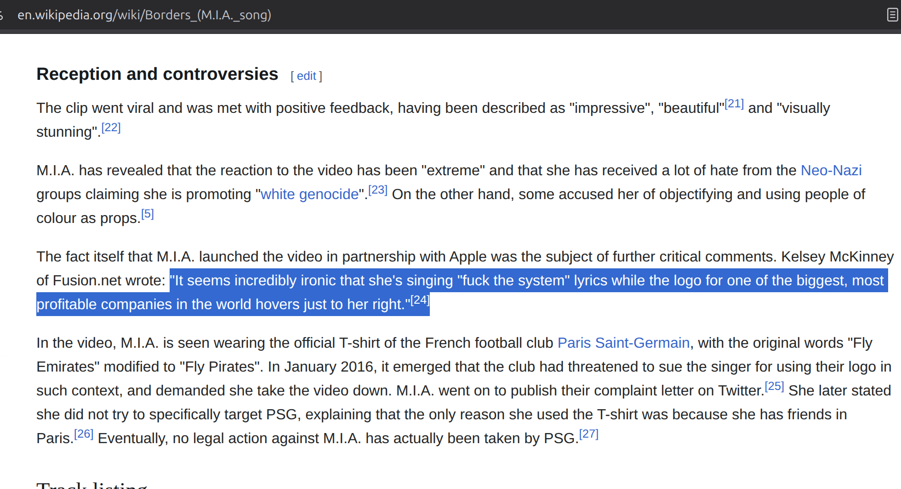

# Scope Creep

## Colorable claim to this project

- `Deportee (plane wreck at Los Gatos)`
  - Nana Mouskouri in a French translation with title "Adieu mes amis" on Le Tournesol (1970)
- `Paper Planes` - MIA
  - This is, on the one hand, a song explicitly about economic disparities between Global North and South. It goes hand-in-hand with, eg., `El costo de la vida`.
  - It's also _literally_ about falsifying visas and passports.
  - _On the other hand_, I Have Misgivings. MIA is a terrible, terrible poser and I don't know if I can, in good faith, represent this song as a legitimate expression of anything except the chorus, which I believe would be transcribed as `"...All I want to do is $ $ $ $. And a check in my name."`
    - _However_, `Hotel California` is currently part of the track listing, and **there are no greater posers in the history of popular music than the _fucking_ Eagles.**
- `Borders` - MIA
  - See above. Also:
  - 
- `Do You Know the Way to San Jose` - Dionne Warwick
  - This is pretty fire tbh. I think it goes alongside `I Can't See Why You'd Want to Live Here`.
  - `Friend of the Devil` - Robert Hunter

## idk

- Bella ciao

## Partially credible claim

### The Suburbs, by the Arcade Fire, and ensuing madness

- `Sprawl II (Mountains Beyond Mountains)`, `City with no Children`, `Half Light II (No Celebration)` - The Arcade Fire
  - These tracks, along with other songs by The Arcade Fire across multiple albums (`No Cars Go`) are, on the one hand, incredibly powerful expressions of the feeling of being trapped, the feeling of being Locked In The Belly of the Beast; the _limitlessness_ of the suburban, modern life, and a searing indictment of the hipocrisy of the, for lack of a better term, Casino State.
    - For example, from `City with no Children`: `... / But do you think your righteousness / Can pay the interest on your debt? / I have my doubts about it / I feel like I’ve been living in / A city with no children in it / A garden left for ruin by a millionaire inside / Of a private prison`
      - _On the other hand_, they are not explicitly Border Songs; they are, again arguably, _songs of the limit_, because they yearn _for_ a limit.
  - However, and this is a sort of meta-commentary, but: Especially on `The Suburbs` (the album overall), the lyricist(s) do this thing where they have presented a work that is coherent and connected, and tells a story _over the course of the entire album_. It's like a conversation between a couple of people, talking about stories and things that have happened over the course of their lives, and the stories and narratives thread in and out of the songs. Sometimes it's a few lines in a verse that refer to another song that more explicitly addresses the topic. There are frequent intertextual references to themes that are names of _other_ songs on the album.
    - Thus, it would be very difficult to analyze any one track in isolation. `Sprawl II` may be the exception for the purposes of this project, but this may be a case where I am reaching to include a song that is deeply personally meaningful to me and resonates with lots of parts of my life and analyses that _do_ form part of this project, but really, remain outside its scope.
    - Additionally: Half Light II _could_ pair well with `Volver`, but... As much as I deeply love that song, I'm not sure it reaches the same echelon as Mr. Gardel's work.

`UPDATE, 8-30-26`: I have begun to suspect that I may need to, in the course of this project, at least read, and perhaps translate, the entirety of the lyrics of that whole album, in the order in which the songs appear. It keeps coming to my mind. Maybe that's `JuSt A pHaSe` I'm in right now.

Maybe not; `Sprawl II` has all these references to how `the city lights shine / they're screaming at us, come and find your kind / ... / they're screaming at us, we don't need your kind / ... `

This is an oddly on-point, albeit highly elliptical and editorialized, version of the protagonist's theme in `Fast Car`: `/the city lights laid out before us / ... / and I, I / I had a feeling that I / ... / could be someone`, only to discover, later on in the song, that `... / I'd always hoped for better / thought that maybe together you and I might find it / ... / take your fast car and keep on driving`

The city lights speak to us of our dreams. They speak to us of what we could become. And maybe sometimes, they remind us that `la vida es sueño / y los sueños / sueños son.`

That you may find yourself `in a beautiful house, with a beautiful wife`; and you may find that `life springs eternal / on a gaudy neon street / ... / lights so bright `; and that (you) `...don't care at all.`

The city lights, from the top of Mulholland Drive, or the last high-water mark* westbound on I-15, `bright light city / gonna set my soul on fire`; or even from the top of Woodland Avenue, just across the border into the city; from the heights of El Paso overlooking Juarez (Or Rosa's cantina): `stand(ing) on the mountain, watch(ing) it burn`, `I come down from the mountain / I was walking in your shoes`; you can run this road back and forward throughout the whole body of work.

And more: `Are you a lucky little lady in the city of light?` `LA Woman` is inextricably linked to the entirety of _The Suburbs_; to _Fast Car_, to _Boulder to Birmingham_ both at the thematic level, as well as the socio-cultural and temporal fabric of the authors. The _Drive-By Mix_ of Poe's _Hey Pretty_ comes into play in a sideways move, invoked by Mulholland, which is unfortunate as this project is beginning to feel more and more like _House of Leaves_.

- _"There was madness in any direction, at any hour. If not across the Bay, then up the Golden Gate or down 101 to Los Altos or La Honda. . . . You could strike sparks anywhere. There was a fantastic universal sense that whatever we were doing was right, that we were winning. . . ._

_And that, I think, was the handle—that sense of inevitable victory over the forces of Old and Evil. Not in any mean or military sense; we didn’t need that. Our energy would simply prevail. There was no point in fighting—on our side or theirs. We had all the momentum; we were riding the crest of a high and beautiful wave. . . ._

_So now, less than five years later, you can go up on a steep hill in Las Vegas and look West, and with the right kind of eyes you can almost see the high-water mark—that place where the wave finally broke and rolled back."_

-Hunter S. Thompson, _Fear and Loathing in Las Vegas_

## Songs about the Casino State

There is a theme that has crept into this project which has the potential to explode out into an entire body of coherent, inter-thematically connected work.
These are songs about risk; about gambling; about failure and **rags-to-riches dreams of hitting it big.** Some are currently included in `Border Songs`.

### Current inclusions

- Mexicali Blues
- Viva Las Vegas
- Leaving Las Vegas

### Inter-thematic neural network

- Atlantic City - Bruce Springsteen
  - This song is capable of producing a decent-length analysis in and of itself
- House of the Rising Sun - Traditional / The Animals
- Deal - Robert Hunter
- Dire Wolf - Robert Hunter
- The Gambler - Kenny Rogers
- Friend of the Devil - Robert Hunter
- Half Light II (No Celebration) - The Arcade Fire
  - Lemme explain: `Now that San Francisco's gone / I guess I'll just pack it in / ... / When we watched the markets crash / The promises we made were torn / ... / Some people say / We've already lost / But they're afraid to pay the cost / For all we've lost / ...`
